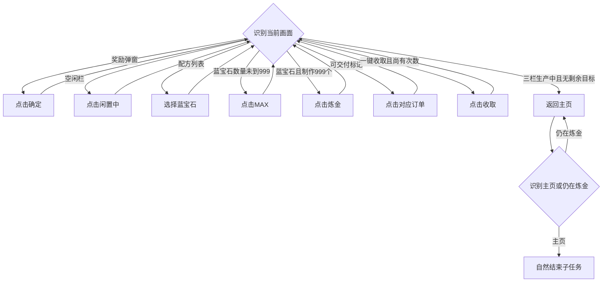

# 炼金订单（DailyAlchemyOrders）

入口为 `DailyAlchemyOrdersStart`，实现位于 `assets/resource/pipeline/daily_alchemy_orders.json`，复用 `agent/completion.py` 的同帧守卫和 `agent/interaction.py` 的中心点击。入口经[统一异常恢复](task_recovery.md)执行主体，完成必须命中本次 `DailyAlchemyOrdersDone`。

## 目标与前置状态

领取炼金收益，交付当前完整可见卡片中可交付的订单，给空闲生产栏补蓝宝石999个，然后回到主界面。用户称呼的“蓝水晶”在当前客户端实际名为“蓝宝石”。不改变已有生产、不选择紫水晶、不使用加速。普通账号7个、会员9个订单均通过动态计数OCR识别；不横向滚动订单列表，未覆盖的卡片不表示已处理。

主体可从主页、已打开的抽屉、炼金总览、奖励确认、配方列表或蓝宝石数量设置页继续识别。队列首次准备仍经过启动模块，不把主体可恢复页面视为绕过启动准备的条件。

## 按当前画面选择动作

`DailyAlchemyOrdersScanOrder` 每轮按以下优先级识别，动作后重新进入同一入口，不依赖上一次点击成功推断页面已改变：

| 看到的内容 | 执行动作 |
| --- | --- |
| 获得奖励标题和确定按钮 | 点击完整确定按钮图片中心；仍在则下一轮再点 |
| 加载／连线提示 | 使用公共加载等待后重新识别 |
| 蓝宝石详情、制作999个、炼金按钮同时命中 | 点击炼金按钮图片中心开始生产 |
| 蓝宝石详情及MAX，尚未命中制作999个 | 点击MAX，下一轮根据实际数量决定继续MAX还是开始生产 |
| 炼金品项标题及蓝宝石配方 | 点击蓝宝石图片，避开下面的紫水晶 |
| 炼金总览及闲置中 | 点击闲置文字中心打开该栏配方 |
| 炼金总览及可交付订单勾选标记 | 按标记到同卡中心的相对偏移点击 |
| 炼金总览及一键收取 | 点击一键收取，有限尝试后继续其他候选 |
| 三栏均炼成中，且无空栏、可交付标记、已知弹窗 | 点击左上返回，识别主界面后自然完成 |
| 主页抽屉中的炼金图标 | 点击该图标图片中心进入炼金 |
| 主界面及抽屉箭头 | 点击箭头图片中心展开抽屉 |

`DailyAlchemyOrdersFinishRouter` 仅处理返回阶段的奖励、加载、主页和仍在炼金页时的返回重试，不重新打开抽屉。旧 `VerifyComplete`、`AwaitDeliveryResult`、`DeliverySucceeded`、`DeliveryRetry` 名称保留为统一入口的兼容路由，不再承担逐步成功状态。

## 图片识别依据

所有新增素材来自MuMu设备内部ADB无损截图1080×1920，经Maa原生归一为720×1280后裁剪，位于 `assets/resource/image/DailyAlchemyOrders/`，不使用桌面窗口截图。

| 目标 | 素材／区域 | 用途 |
| --- | --- | --- |
| 奖励确定 | RewardTitle720、RewardConfirm720；标题ROI `[250,450,220,110]`，按钮ROI `[240,690,240,110]` | 标题与按钮同帧匹配，替代旧确定OCR |
| 闲置栏 | EmptySlot720；ROI `[290,200,140,520]` | 纵向寻找实际闲置栏，不固定点击第三栏 |
| 配方列表 | RecipeListTitle720、BlueRecipe720 | 同帧标题及首行蓝宝石图文，不选择紫水晶 |
| 蓝宝石详情 | BlueDetailTitle720；ROI `[70,400,120,65]` | 限定MAX与开始生产的配方 |
| 最大数量 | MaxButton720、BlueQuantity999720 | 只在实际显示制作999个时提交；数量图片ROI `[285,655,155,60]` |
| 开始炼金 | RefineButton720；ROI `[240,800,240,90]` | 点击完整蓝色炼金按钮中心 |
| 三栏生产中 | Refining720；三栏独立局部ROI | 每栏必须正向识别炼成中，不用空栏未命中代替生产状态 |
| 主页抽屉 | DrawerArrow720、DrawerAlchemyIcon720 | 按图片位置点击，移除派遣队1 OCR与炼金固定落点 |
| 炼金总览 | Title720、CollectButton720及动态订单计数OCR | 同帧页面守卫，并排除奖励、配方列表与详情弹窗 |
| 可交付订单 | DeliverableMarker720；ROI `[25,938,525,52]` | 保留原完整可见卡片范围和标记相对偏移 `[67,76,0,0]` |

新增商品、按钮、数量及页面模板均用MaaFramework内置TemplateMatch；阈值0.90～0.96为初始匹配参数，不代表实测准确率。动态订单数量、公共加载提示及主页识别复用现有OCR。动作前仅等待命中控件局部稳定300ms，最长1500ms，不等待全屏静止。

## 次数与异常边界

- 一键收取在没有收益时仍显示，不能无限点击，因此同任务最多尝试三次。收取不记录为业务成功；是否出现奖励及是否可以结束均由后续实际画面决定。
- 奖励确定最多30次；进入空栏、选择配方、MAX及开始生产各最多9次；交付10次；抽屉与入口各6次；返回3次；统一分发最多100次。单轮未知页面超时12秒。上限防止持续输入，不能替代物理画面的完成条件。
- 收取、交付和开始生产的计数列入 `TkfmRecoveryConfig.attach.preserve_hits`，任务级重启不清零，不重新发放操作额度。既有生产只读取状态，不中止、不改数量；本轮人工更正新建1个队列为999的停止步骤不写入自动流程。
- 上限耗尽而页面仍有目标时，完成守卫仍不允许返回成功。未知配方、MAX后未达到999、未知确认弹窗均不盲点，走通用恢复及原暂停／重启设置；`DailyAlchemyOrdersAbortToMain` 保留名称但明确失败，不把安全降级记为正常完成。
- 完成要求三个生产栏均识别炼成中、没有可交付订单或空栏及已知弹窗；返回后正向识别主界面并自然结束子任务，不用StopTask终止父任务。一次点击成功只表示输入已发出。

## 现场流程依据

2026-11-12人工通过ADB逐步观察：奖励确定 → 炼金总览空闲栏 → 炼金品项 → 蓝宝石数量页 → MAX显示制作999个 → 炼金 → 总览蓝宝石999个生产中。另采集主页抽屉和炼金入口。每次操作后的截图均保存在本地记录引用目录。原三个720模板保留；新增图像来源与未覆盖分支见维护者本地记录。本轮未运行新增自动化，用户自行测试；人工操作不代表代码已验证。
