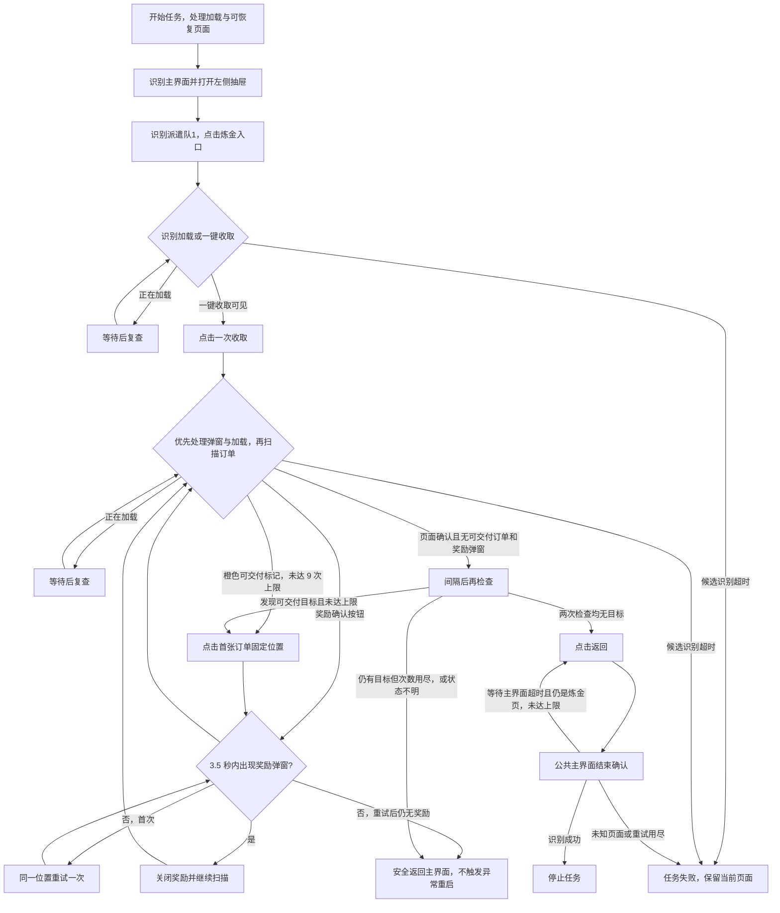

# 炼金订单（DailyAlchemyOrders）

入口节点：`DailyAlchemyOrdersStart`；实现文件：`assets/resource/pipeline/daily_alchemy_orders.json`、`agent/completion.py`。

入口经 [统一异常恢复](task_recovery.md) 执行 `DailyAlchemyOrdersStartAttempt`；首次异常按“遇到故障时行为”重启或暂停，最终失败按继续策略停止或跳过下一步骤。

## 前置状态

- 游戏位于主界面，左侧抽屉和炼金页面可访问。
- 炼金收益或可交付订单可以为空。
- 普通账号为 7 个订单，会员为 9 个订单；计数 OCR 兼容 `0～7/7` 和 `0～9/9`，无需手动切换会员选项。

## 主流程

1. 打开主界面左侧抽屉并进入炼金页面。
2. 出现“一键收取”时领取已完成的炼金收益并关闭奖励弹窗。
3. 扫描当前页面的可交付订单，逐项点击交付；每次点击后只以奖励弹窗确认这次交付是否生效。
4. 确认炼金标题、订单计数与收取按钮可见，且当前可见范围内无可交付标记、无奖励弹窗；间隔复查后再返回主界面。

收取按钮存在不代表有收益；空收益时仍会点击一次，然后在没有奖励弹窗的情况下进入订单扫描。
检查范围沿用当前可见订单，不滚动扩大处理范围，不能据此证明不可见订单均已完成。
交付动作固定点击首张可见订单卡片 `[85,1040]`，避免随机偏移落到图标边缘导致点击未生效。
每次点击后等待奖励弹窗；弹窗出现即关闭后继续扫描。若无弹窗，只允许原位置重试一次；重试后仍无弹窗即判定已无可确认交付，通过 `DailyAlchemyOrdersAbortToMain` 处理加载和奖励弹窗后安全返回主界面。
橙色标记在订单清空后可能仍然存在，不能单独作为继续连点的依据；交付最多 9 次，达到上限同样安全返回，不交给统一异常恢复重启游戏。
打开抽屉与返回主界面由后续识别承接，不等待整屏静止。公共结束确认见 [公共主界面恢复](common_navigation.md)。

## 页面识别

| 页面状态   | 识别目标          | 识别方式       | ROI/素材         |
| ---------- | ----------------- | -------------- | ---------------- |
| 主界面     | `CommonMainReady` | And + OCR      | 通用主界面节点   |
| 左侧抽屉   | 派遣队1           | OCR            | 抽屉状态区       |
| 收取按钮   | 一键收取或键收取  | OCR            | 炼金页下方按钮区 |
| 可交付订单 | 橙色可交付状态块  | HSV ColorMatch | 订单列表区域     |
| 炼金页面   | 炼金              | OCR            | 页面标题区       |

## 异常与分支

- 当前客户端无可收取收益时仍显示“一键收取”；任务会点击一次，未出现奖励弹窗时继续扫描订单。
- `TaskCompletionGuard` 在同一张截图中检查页面依据、可交付标记和奖励正文，
  所有必要识别均成功执行才可作出完成判断。识别未能执行不等同于没有目标。
- `DailyAlchemyOrdersVerifyComplete` 与 `DailyAlchemyOrdersReturnMain` 分别检查一次，
  复查最多三次进入；交付共用 12 次上限，不为复查重置计数。次数仅用于限制重试，不能替代实际完成判定。
- 交付、扫描和复查节点的 `on_error` 都进入 `DailyAlchemyOrdersAbortToMain`；达到上限属于安全降级，不交给 `TkfmRunWithRecovery` 重启游戏。
- 奖励弹窗统一由 `CommonCloseReward` 关闭后回到订单扫描。
- 返回点击前保留 300 毫秒稳定等待，仅检查左上角返回箭头区域 `[15, 52, 85, 44]`，
  单次稳定等待上限 1500 毫秒，不检查动态角色或整屏；局部稳定不保证游戏已经接受点击。
- `DailyAlchemyOrdersDone` 优先处理加载与礼包，识别主界面后进入公共观察与结束确认。
  目标页候选超时 1500 毫秒后，只有重新识别到炼金标题才重试返回，累计最多点击 3 次。
  未知页面或次数用尽时失败；重试不重新收取或交付订单。

## 完成状态

- 正常目标：处理当前可见的可交付订单，或没有可交付订单时返回。
- 成功条件：当前可见范围连续两次通过完成检查，再返回并确认主界面。
- 未知状态、必要检查不可用或上限耗尽且仍有目标时安全返回游戏主界面并记录为降级完成；正常完成同样返回主界面。
