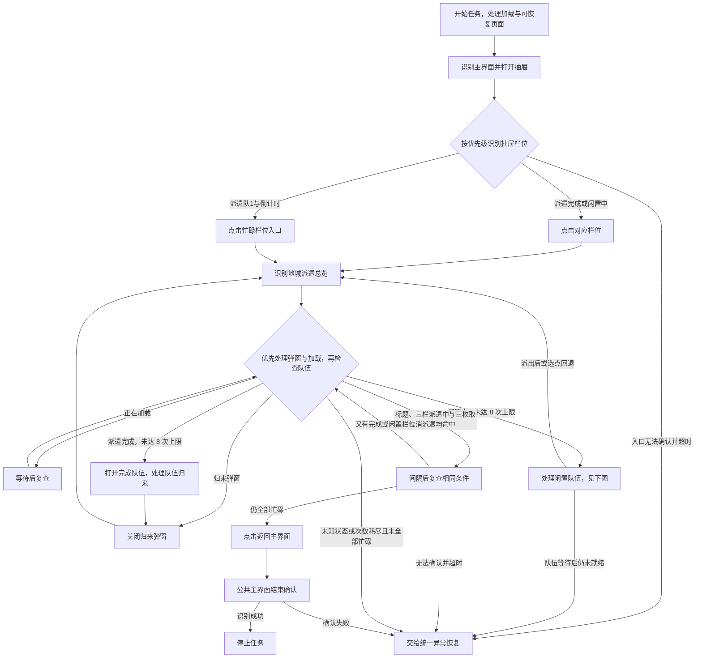
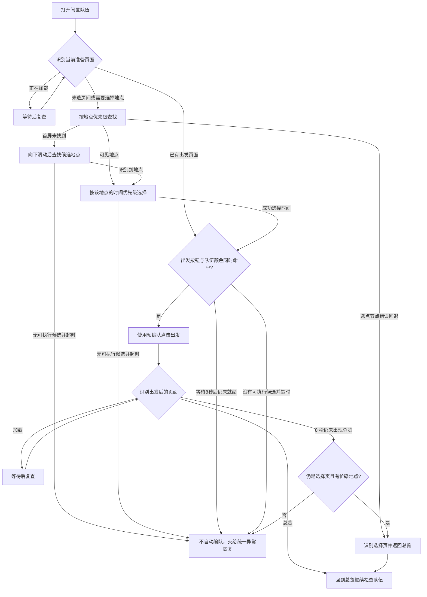

# 每日派遣（DailyDispatch）

入口节点：`DailyDispatchStart`；实现文件：`assets/resource/pipeline/daily_dispatch.json`。

入口先经 `TkfmDispatchSchedule` 处理立即执行或一次性预约，再由 `DailyDispatchRunNow` 经 [统一异常恢复](task_recovery.md) 执行 `DailyDispatchStartAttempt`。操作顺序可按配置不同，完成标准始终是全部三队已经派出。

## 前置状态

- 游戏位于主界面，地城派遣功能已解锁。
- 确认“派遣地点优先级”和“派遣时间优先级”。
- 所有需要助手处理的派遣栏位均已在游戏内编好可出发队伍；助手不会自动编队或补充角色。

## 根据倒计时智能续约

“每日派遣”新增复选项“自动计算下次派遣时间”，默认关闭。开启后照常回收已完成队伍、处理闲置队伍；三队均派遣中时，返回主页前读取三张卡片各自的 `hh:mm:ss`，以最长值加5秒作为下一次执行时间。三队已经在派遣时同样读取，不直接结束后丢弃倒计时。

时间是动态文字，使用局部OCR；标题、三组派遣中状态和取消按钮仍沿用原确认流程。三个时间均完整有效才登记预约，日志逐队显示原文、最长值及预计时间；任一读不到则记录不预约原因，当前派遣继续正常返回主页。

- 原图依据为既有设备内部截图，按720×1280基准读取，三个时间ROI为 `[270,940,120,35]`、`[270,1070,120,35]`、`[270,1200,120,35]`；新增ROI尚待实机确认。
- `DailyDispatchReturnMainWhenAllBusy` 调用 `TkfmDispatchSchedule` 的 `countdown` 模式采集；`DailyDispatchLeaveOverview` 负责原返回动作。外层确认派遣及可选关闭游戏成功后才保存下一次预约。
- 到点单独运行派遣，使用登记时地点、时长及调度选项快照。成功派出后读取新的倒计时并续约；失败或停止不创建下一次预约。队列忙碌时等待空闲，不抢占设备。
- 每实例只有一份派遣预约；手动运行产生的新预约替换尚未开始的旧预约。取消请使用日志标题栏的取消按钮；取消勾选只影响后续运行，不会删除此前已登记的预约。
- 开启“自动计算下次派遣时间”后，手动预约时间灰显且禁止编辑，保留原值；执行时忽略手动时间，直接读取当前派遣倒计时。关闭自动计算后恢复手动编辑和原预约逻辑。MuMu启停、关闭游戏、离线错过不补跑均沿用下述约定。

每天固定时间运行整个配置见[配置每日定时执行](daily_schedule.md)，该入口执行勾选的全部任务；倒计时预约只执行派遣。

## 一次性定时派遣与省电

关闭自动计算时，在“每日派遣”选项开启“定时派遣”，设置“派遣预约时间”，然后点击开始登记预约。本次只登记，不立即派遣；其他勾选的任务仍按原队列执行，因此只想预约派遣时只勾选“每日派遣”。日志显示预约日期，标题栏可取消尚未开始的预约。再次登记会替换尚未执行的预约。

- `HH:mm`：电脑本地时区的下一次该时刻；当天已过则为次日。
- `yyyy-MM-dd HH:mm`：未来的指定日期，只执行一次。
- 到点如设备正在执行其他任务，等待其空闲，不并发抢占。仅运行本实例的派遣，不运行商城或其他日常；地点和时长采用登记时快照。
- 执行前按当前“资源类型”重新启动对应服务器的游戏，复用左上返回按钮的启动广告关闭流程和主页识别，再回收并派出三队。
- 在“定时派遣”内勾选“派遣成功后关闭游戏”时，成功结束游戏进程；失败或手动停止保留现场。

“定时启停MuMu模拟器”右侧问号悬停提示为“当用户安装mumu模拟器时，可自动开关模拟器实现省电”。此功能只支持所选 ADB 设备带完整 MuMu 元信息的 MuMu 12 实例。路径、实例编号和 ADB 地址在登记时保存，不向其他实例回退。

预约快照、到点设备核对及其他实例占用判断统一读取前端控制器的 `processor.Config.AdbDevice`，不依赖持久化设备值在内存中的 JSON 类型。ADB 路径或地址为空时拒绝登记；旧版已保存空设备信息的预约需要重新登记，不自动绑定到当前设备。

1. 可选“预约后关闭MuMu模拟器”：登记后等待当前队列空闲，关闭指定实例。
2. 到点用 MuMuManager 启动同一实例，最多等待三分钟使原 ADB 设备启动完成，再重建前端连接和 Agent。
3. 可选“派遣成功后关闭MuMu模拟器”：派遣成功且队列空闲后关闭指定实例；其他助手实例正在使用同一设备时延后关闭。

预约按实例持久保存，并在启动设备前标记已领取；失败、中断和完成都不会自动再次执行。定时专用队列临时停用前端的任务前后动作和失败后设备自动切换，收尾恢复原设置。

助手必须保持运行，电脑须保持唤醒；不会自动唤醒休眠电脑。扩展需要首次连接/资源初始化后加载，助手重启后须先连接一次才能恢复未来的预约；已错过的预约失效，执行中断不补跑。关闭模拟器不等于关闭助手。

## 主流程

1. 打开左侧抽屉，根据栏位状态进入地城派遣总览。
2. 优先打开“派遣完成”栏位，收回队伍并关闭归来弹窗。
3. 打开“闲置中”栏位，按配置顺序选择地点和派遣时长。
4. 检查预先编好的队伍是否满足出发条件；满足后派出，继续扫描其他栏位。
5. 总览标题、三个栏位的“地城派遣中”及对应三枚“取消派遣”同时命中后，间隔复查一次，仍全部命中才返回并确认主界面。
6. 队伍未就绪时最多周期识别 8 秒，不进行编队；仍不可出发则明确失败，交给统一恢复，不按完成跳过。

“全部忙碌”通过 `__DailyDispatchSlot1Busy` 至 `__DailyDispatchSlot3Busy` 的独立窄 ROI
以及 `__DailyDispatchSlot1Cancel` 至 `__DailyDispatchSlot3Cancel` 的按钮 ROI 逐栏确认；
`DailyDispatchVerifyComplete` 与返回节点分别检查一次。完成和闲置候选优先，
复查期间新出现的目标仍交回原处理链。出发后返回总览继续扫描，不是派出一个队伍就结束。
公共结束确认见 [公共主界面恢复](common_navigation.md)。

闲置队伍的选点、选时与出发子流程如下。

选项通过调整候选顺序生效；图中不将某一个地点或时长视为固定默认。
滑动后的候选列表、各时间节点的继续尝试与错误回退以 Pipeline 为准，不表示任意选点失败都能返回总览。

## 页面识别

| 页面状态   | 识别目标                          | 识别方式            | ROI/素材         |
| ---------- | --------------------------------- | ------------------- | ---------------- |
| 抽屉栏位   | 派遣完成、闲置中、派遣队1与倒计时 | OCR/And             | 左侧抽屉栏位区   |
| 派遣总览   | 地城派遣                          | OCR                 | 页面标题区       |
| 归来弹窗   | 队伍归来/隊伍歸來                 | OCR                 | 弹窗内容区       |
| 地点与时间 | 地点名称和对应时间按钮            | OCR + target offset | 选择页面         |
| 队伍就绪   | 出发按钮和队伍槽蓝绿色            | And + ColorMatch    | 队伍与底部按钮区 |
| 三队均派出 | 每栏地城派遣中及取消派遣按钮 | OCR + And | 三组独立栏位 ROI |

“取消派遣”三个 OCR ROI 基于已有设备截图的 720×1280 基准，分别为
`[500,925,145,60]`、`[500,1055,145,60]`、`[500,1185,145,60]`。
此处 OCR 用于安全复核完整按钮文字，不执行取消操作；不得用全屏重复文字数量代替逐栏判断。

## 异常与分支

- 打开抽屉、从倒计时或可操作栏位进入总览、返回主界面均由下一页面识别承接。
  本模块不等待整屏静止，改为每秒周期识别；点击前的局部稳定等待为 300ms，超时 1500ms。
- 点击“出发”后优先等待游戏自动返回总览，不根据过渡期间其他地点的“正在派遣中”立即点击返回。
  8 秒内未进入总览时，只有选择页的“Bonus 奖励条件”和忙碌地点文本同时命中才执行返回；
  返回后重新判断总览或经公共节点确认主界面。出发与该回退均不等待整屏冻结。

- 队伍未满足出发条件时不自动编队或补充角色，等待后仍不可出发则明确失败，不使用返回主页的成功分支掩盖闲置队伍。
- `DailyDispatchCheckPreconfiguredTeam` 仅在识别到“出发”按钮后进入，不能以无条件节点抢在地点选择之前，否则会在尚未选点时误判队伍未就绪。
- 选点节点配置了返回总览的错误回退；返回后会继续扫描，可能再次进入闲置栏位，受最多 8 次打开限制。
  各时间节点的失败路径不同，不能保证所有“无可选时间”情形都能正常退出。
- 完成与闲置候选未命中后，必须连续两次同时确认总览标题、三栏派遣中与三枚取消派遣才执行正常返回。
  抽屉入口无法确认时不再仅凭主界面仍可识别就结束。
- “派遣完成”和“闲置中”栏位分别最多打开 8 次，为三队留出额外尝试，但异常识别不能
  无限重复。达到上限后只有三栏忙碌仍可通过完成检查；仍有目标或总览 6 秒内无法确认已知分支时失败，
  交由统一恢复。旧 `DailyDispatchReturnMainAfterOverviewTimeout` 与
  `DailyDispatchStopAfterOverviewTimeout` 也只转入明确失败节点，不再提供成功跳过出口。
- 首次异常按“遇到故障时行为”重启游戏或暂停；已派出的队伍由页面状态识别，不会取消重派。暂停解除或再次异常后执行失败继续策略。
- 地点/时间优先级通过 `pipeline_override` 调整 `next` 顺序，目标节点必须预先存在。
- 定时派遣入口显式传递空对象 `custom_action_param: {}`。自定义动作会把缺省参数兼容为 `null`、非法 JSON 转为可诊断失败，并且整个执行入口由异常保护包围，不能因参数解析错误终止前端。

## 完成状态

- 正常目标：收回完成队伍，并使用预编队处理可出发的闲置队伍。
- 正常成功条件：总览标题、三栏派遣中和三枚取消派遣均经两次检查，再返回并确认主界面。
- 队伍未就绪、上限耗尽且仍有目标、状态不明或入口无法确认时失败，交给统一恢复，不因只识别到标题或回到主页而报完成。
