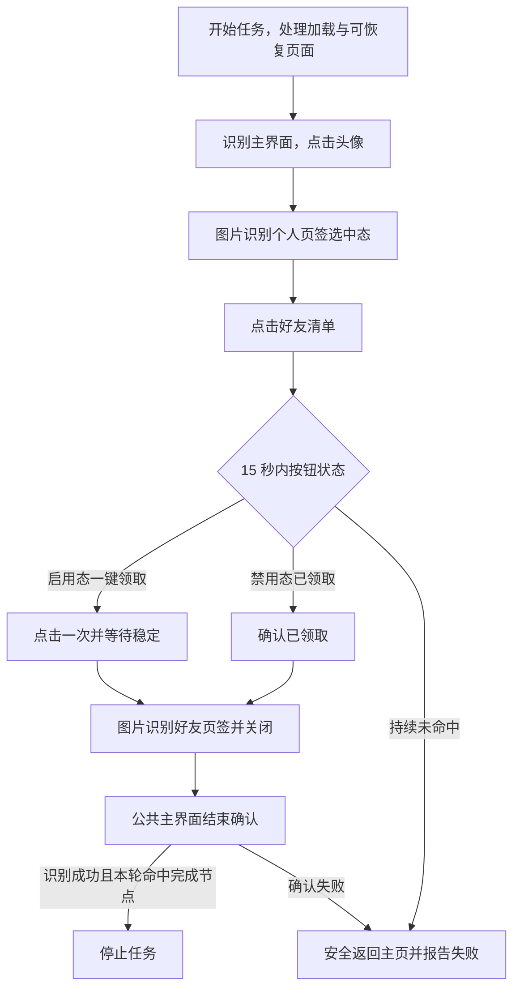

# 领取体力（DailyFriendStamina）

入口节点：`DailyFriendStaminaStart`；实现文件：`assets/resource/pipeline/daily_friend_stamina.json`。

入口经 [统一异常恢复](task_recovery.md) 执行 `DailyFriendStaminaStartAttempt`；首次异常按“遇到故障时行为”重启或暂停，最终失败按继续策略停止或跳过下一步骤。任务成功必须在本轮实际命中“可领取”或“已领取”视觉节点，安全返回主页不能代替完成。

## 前置状态

- 游戏位于主界面，或已经停留在玩家信息的好友清单页。
- 好友页通过固定 720×1280 视觉模板确认；可领取和已领取按钮分别使用独立模板，不依赖 OCR 判断。

## 主流程

1. 从主界面点击头像进入玩家信息页，以“个人”页签选中态图片确认玩家信息页。
2. 点击好友清单，使用“好友清单”页签选中态图片确认页面。
3. 在按钮区域低频复查：启用态“一键领取”命中时点击一次；禁用态“已领取”命中时直接进入返回流程。
4. 点击后等待局部画面稳定，再关闭玩家信息并确认主界面。
5. 15 秒内既未命中可领取也未命中已领取时，安全返回主页并报告失败；统一恢复最多重启一次。

复查间隔由 Pipeline 的 `post_delay` 与 MaaFramework 默认识别间隔共同限制，不使用项目侧循环或高频连续截图。

## 页面识别

| 页面状态 | 识别目标           | 识别方式      | ROI/素材                         |
| -------- | ------------------ | ------------- | -------------------------------- |
| 主界面   | `CommonMainReady`  | And + OCR     | 通用主界面节点                   |
| 玩家信息 | 个人页签选中态     | TemplateMatch | `ProfilePersonalSelected720.png` |
| 可领取   | 启用态一键领取     | TemplateMatch | `OneClickClaim720.png`           |
| 已领取   | 禁用态一键领取     | TemplateMatch | `OneClickClaimed720.png`         |
| 好友页面 | 好友清单页签选中态 | TemplateMatch | `FriendListSelected720.png`      |

## 异常与分支

- 启用态与禁用态模板必须分别命中；两者分数在本项目设备截图中约为 `0.998` 与 `1.000`，交叉匹配低于 `0.82`，阈值使用 `0.92`。
- 启用态按钮最多点击一次，点击后通过全屏短时稳定等待吸收领取中的 `LOADING` 动画，再识别好友页签关闭页面。
- 已领取状态是正常完成分支，不点击灰色按钮，也不触发异常恢复。
- 15 秒内未命中两种按钮状态时，先通过公共导航返回主页，再由外层恢复包装检查本轮是否命中完成节点；未命中则明确失败，按“重启/暂停”和最终继续策略处理。
- 玩家信息页残留、好友列表尚未切换或按钮未加载时不猜测点击，不把安全返回主页视为成功。

## 完成状态

- 成功条件：本轮命中启用态按钮并完成点击，或命中已领取状态；随后返回并确认主界面。
- 安全退出位置：游戏主界面；未命中完成节点时任务结果仍为失败。
