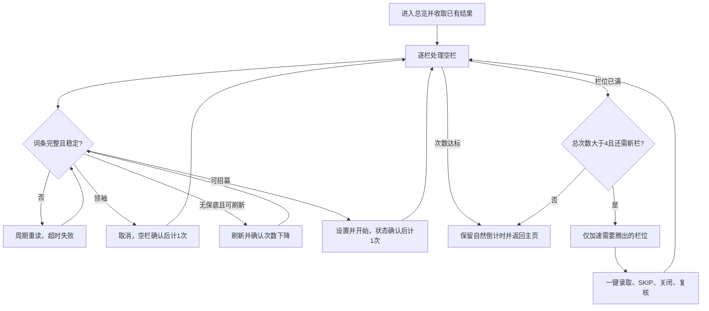

# 全境征才（DailyRecruitment）

入口节点：`DailyRecruitmentStart`；实现文件：`assets/resource/pipeline/daily_recruitment.json`、`agent/recruitment.py`。

入口经 [统一异常恢复](task_recovery.md) 执行 `DailyRecruitmentStartAttempt`；首次异常按“遇到故障时行为”重启或暂停，最终失败按继续策略停止或跳过下一步骤。

## 前置状态与次数

- 全境征才功能已解锁；游戏由队列首次执行模块前自动检测并按需启动，服务器在“资源类型”选择。
- 只提供“全境征才总次数”（1–100，默认4），保留内部选项ID `全境征才循环次数` 兼容旧配置。“全境征才立即招募”开关移除，旧子选项的次数提升为直接选项，数值不乘四。
- 成功开始一栏征才计1次，因领袖词条取消该栏也计1次。已有招募及已有结果不计入本次新处理次数，同一领袖栏位在本任务内只计一次。
- 次数不多于4时不使用加速券，只处理可用空栏；已有招募占满栏位时自然保留并结束。多于4次时按需要腾出栏位，最终保留最多四栏自然倒计时，不在任务里等待数小时。

## 主流程

1. 进入召唤页和全境征才，先领取已有结果，再按1→4扫描空栏。
2. 打开张贴榜单后，确认设置页无弹窗；每秒逐槽OCR读取五个词条及剩余刷新次数，连续两次完整一致才决策。动态词条和次数没有固定可靠模板，保留OCR；栏位状态及固定按钮使用图片。
3. 领袖取消并确认回到空栏后计1次；保底2星组合设为9小时并选词条；无保底且可刷新时先刷新，计数恰好减少一次且五槽再次稳定前禁止再操作。刷新或动作额度耗尽后直接默认1小时征才，不选词条。开始后必须看到本栏招募中或待录取，才计1次。
4. 填满可用栏位或用尽次数后，`DailyRecruitmentPlanVacancies` 根据剩余次数和已有待录取数量，保存本批需要加速的栏位。至多4次时计划始终为空；多于4次也只加速还需腾出的栏位。
5. 逐栏图片识别紧急征召及票券确认，等待计划栏位变为待录取；其他栏位保持自然倒计时。只点击底部一键录取，再识别SKIP和角色汇总关闭。连续两次确认已收取栏位为空、其他栏位仍自然招募，才清理本批状态并扫描下一批。
6. 达到总次数后不再加速，返回并二次确认主页。全部栏位均因领袖保留时提前结束，避免重复打开同一领袖栏位。

例如空四栏、无领袖和已有结果时：12次依次新开4栏、加速收取4栏、新开4栏、加速收取4栏、最后新开4栏自然等待；5次只需加速收取1栏，再补开1栏。

## 页面识别

| 页面状态   | 识别目标                                   | 识别方式      | ROI/素材                                  |
| ---------- | ------------------------------------------ | ------------- | ----------------------------------------- |
| 主界面入口 | 召唤按钮                                   | TemplateMatch | `DailyRecruitment/SummonText.png`         |
| 征才总览   | 全境征才、张贴榜单、一键录取               | OCR/And       | 标题、四栏及底部按钮区                    |
| 词条决策   | 五槽各一个已知词条、刷新次数；连续两次一致 | Agent 内 OCR  | `TAG_SLOT_ROIS`、`TAG_ROI`、`REFRESH_ROI` |
| 招募设置   | 招募时间、开始招募                         | OCR           | 设置页和底部按钮                          |
| 阻挡弹窗   | 提示、确认、警告；不自动点击弹窗           | OCR           | `__DailyRecruitmentBlockingPrompt`        |
| 立即处理   | 紧急征召、人才录取、空栏位、票券提示及确定 | TemplateMatch/Agent | `DailyRecruitment/*720.png`，各栏局部 ROI |
| 加速确认   | 紧急录用证提示与完整蓝色确定按钮 | TemplateMatch/And | `EmergencyPrompt720.png`、`EmergencyConfirmButton720.png`；按钮ROI `[382,748,220,75]` |
| 批量收取   | 一键录取、SKIP、Character Get、关闭 | TemplateMatch/And | 底部按钮、右上角及结果汇总标题 |

## 异常与分支

- 已在招募中的栏位不会进入设置页；`DailyRecruitOverviewComplete` 必须先确认总览标题，再逐栏确认“停止招募 / 紧急征召 / 立即招募”、“人才录取”或本轮明确跳过且仍为空的领袖栏位。仅标题命中或空栏位 OCR 暂时漏识别均不能认定四栏完成，会继续尝试；无法确认则超时失败。每栏刷新动作最多 3 次，额度耗尽后的兜底仍须通过完整词条与计数复核，但兜底不调整招募时间，也不选择词条。
- 每个空栏位在每轮最多打开一次；出现领袖词条并取消设置后，该栏位保持为空，但总览 Router 会跳过已处理栏位并继续扫描后续栏位，避免重复打开形成死循环。异常重启保留逐次记账和领袖栏位状态，仅重新读取尚未确认的页面。
- 无有效词条、任一槽漏识别、候选冲突或刷新次数不明时不刷新、不调整招募设置，也不兜底招募；等待下一次识图，超时保留页面并失败。
- 词条优先按五个按钮的窄 ROI 逐项识别，先丢弃非中文字符，再归一别名并完整匹配已知词条，例如“·守护者”清洗为“守护者”；宽 ROI 的单词检测框必须对应唯一槽位才用于补充，不再猜测合并文本的位置。五槽词条必须各自明确且不重复；“輔助者”可规范为“辅助者”，辅助者沿用保底组合判断，不能按无保底刷新。
- 每个 `DailyRecruitmentSlotNDecision` 都是完整读取的入口，并在分支间发现画面变化时重新进入。刷新前保存本栏位快照，次数未减少时即使仍看到相同词条也不会再次点击刷新；即使次数已下降，也须等待五槽文字连续两次一致。刷新未确认或弹窗持续存在时超时停止，不替用户关闭未知弹窗。
- 快照按任务和栏位隔离，每轮开始清理；选词条、调整时间和开始招募前均重新核对当前页面、词条及计数与已批准快照一致。不能从“应刷新”分支直接放行兜底，也不能拿上一栏位或刷新前的缓存提交。
- 入口优先领取已有结果；本批填栏后才规划加速。`DailyRecruitmentImmediateSlotNRouter` 只处理计划内第N栏，确认票券后等待待录取，不重复点击异步更新期间暂留的旧按钮。
- 四个 `DailyRecruitmentImmediateSlotNConfirm` 共用完整按钮图片（192×48），联合票券提示确认弹窗身份，`box_index: 1` 返回按钮框。`target: true` 加 `[80,18,-160,-36]` 偏移，将点击区域收缩到本次图片命中框中心32×12像素；不在整个识别框随机点击，也不使用固定屏幕坐标。
- 确认按钮局部稳定300毫秒（最长1200毫秒）后点击，等待1秒再识别：优先本栏待录取，再尝试仍在的同一确认弹窗。每栏每批最多三次确认，现有批次初始化重置此额度；不再次点击紧急征召，不用固定重复点击代替页面判断。三次耗尽后仍不能确认完成则按原15秒候选等待超时和统一恢复规则失败。
- 完整按钮素材来自2026-11-07 02:57:28原生错误截图，原帧720×1280，裁剪 `[394,760,192,48]`，无缩放或有损处理。该次故障记录显示原确认落点接近按钮下沿，确认弹窗未消失，而旧分支只等待待录取直到超时重启；新版补齐识图中心落点和弹窗未消失的有界重试。此结论来自历史证据，改动尚未实机验证。
- `DailyRecruitmentImmediateBatchRouter` 要求所有计划栏位已就绪，其他栏位可自然招募或保留领袖；至少一栏待录取才一键领取，不点击单栏录取。
- 进入、刷新和招募后的页面流转均周期识别目标状态，不等待整屏动画静止；循环入口以完整“全境征才”标题触发初始化，
  不依赖收取已有结果后才进入循环计数。
- 次数独立于批次数：`TkfmRecruitmentAttempt1..100` anchors记录逐栏开始或领袖跳过，`TkfmRecruitmentPending`保存待确认动作。每批仅重置交互额度，不清除总账和领袖保留状态。
- `DailyRecruitmentCycleCompleted` 只负责批次收尾，不是次数计数器。收取和汇总关闭均实际发生且页面连续复核后，只释放已收取的栏位状态；自然招募和领袖状态保留。恢复子任务共享anchors，禁止按完成轮数重新发放额度。
- 一键录取后由 `DailyRecruitmentImmediateResultRouter` 持续识别右上 SKIP 和带 `Character Get` 标题的汇总关闭按钮；关闭后才进入 `DailyRecruitmentImmediateCollectReturnRouter` 确认已收取栏位为空且未加速栏位仍招募中。收取请求等待期间不接受短暂的空总览作为本轮完成，角色展示阶段也不能直接跳到完成节点。SKIP 不等待整屏冻结；关闭点击仅等待按钮局部，结果页未离开时有限重试。移除盲点底部坐标与未经识别的完成出口，未知页面超时交给统一异常恢复。
- 入口收取通过 `DailyRecruitmentCollectReturnRouter` 返回，其他栏位此时刚好到时仍可在后续批次收取。每批一键录取、SKIP和汇总关闭沿用有限次数，超时不视为完成。
- 征才的导航、开栏、选词、调整时间、开始招募与返回动作均只等待对应控件局部稳定，最长 1200 毫秒，不再等待整屏背景冻结。批量完成及全部领袖跳过结论按任务和轮次隔离，状态不一致或出现弹窗时重新观察。
- 参数损坏、非法栏位或标签索引不触发点击；索引错误同时撤销本栏提交许可，初始化失败有明确诊断，不按成功继续。
- 固定控件模板均采自 ADB 设备内部截图，统一为 720x1280 后无损裁剪；阈值是匹配参数，不代表实测准确率。动态词条、刷新数量及既有总览文字仍保留 OCR；票券确认使用固定提示文字与确定按钮模板双重匹配。
- 栏位处理完成后统一返回总览 Router；设置页联合识别时间标记、“开始招募”与“取消”，其中时间标记兼容实机 OCR 仅读出“时间”的情况。非保底兜底直接点击“开始招募”，必须有本栏位完整、有效的已批准招募决策；不识别时间模板、不调整时间，也不进入选词流程，状态不匹配时停止。
- 设置页和取消恢复的无弹窗条件由 `DailyRecruitNoBlockingPrompt` 显式检查，只有阻挡弹窗识别正常执行且未命中才放行；识别异常或无法启动时返回失败。MaaFramework 5.14.3 的 `And` 子识别不会应用节点级 `inverse`，不能把反向节点放进联合条件。

## 选词恢复与决策日志

- 普通日志按“检测到哪些词条 → 准备选择哪些、为什么 → 实际选中并提交 → 已确认的结果”说明每栏征才。没有SR保底且刷新用尽时明确写“不选任何词条、默认1小时”；领袖明确写“保留、不招募”；保底组合列出预计最低品质及可能角色，不能说成已获得。刷新后确认新词条，收取后确认返回总览；目前不读取实际获得的角色姓名。技术点击细节和重试额度保留在详细日志及流程配置，普通加速提示只说明已点击确认、正在等待。
- 提交快照按本次任务与栏位保存，确认开始后使用该快照回报实际选词；缺失则明确提示记录不可用，不拿算法候选冒充已选。相同阶段的相同词条说明只输出一次，任务切换及每轮开始清除说明缓存。
- 四栏保底及兜底开始招募都用 `StartRecruitButton720.png` 定位完整按钮，再用 `ClickRecognitionCenter` 点击命中框中点；不固定点击 `(500,1045)`，也不在文字框内随机落点。按钮来自2026-11-08保留现场的设备内部截图，原始1080×1920统一至720×1280后裁剪 `[395,1024,193,49]`；不是桌面窗口截图，匹配参数尚未实机验证。
- 点击后按“加载 → 本栏已开始 → 原设置页仍可提交”识别；只有原词条和分支仍获批准才补点，保底还须确认9小时及实际选中词条。每分支每栏每轮最多点击三次，动作后至少等待1秒，额度随批次重置；未知页面、超时或额度耗尽按故障处理。只有本栏已开始或已可录取才记一次，点击未生效不计次数。
- `DailyRecruitmentSlotNNineHoursReady` 优先识别当前是否为 9 小时；已设置时直接选词，否则经 `SetNineHours` 设置一次后等待确认。保底分支提交条件同时包含 9 小时模板和本栏决策复核，避免已设 9 小时时再次减为 8 小时。
- `DailyRecruitmentSlotNRecruitFallback` 只路由到本栏位开始招募节点，不经过 `NineHoursReady`、`SetNineHours` 或任何选词节点；游戏默认时间保持 1 小时。
- `DailyRecruitmentSlotNSelectTagKRouter` 依次判断目标组合已选全、当前目标已选、当前目标待点击，仅在 9 小时保底分支使用。每次点击后回到本步 Router，通过选中边缘模板复核；不重复点击已选词条。每个选词点击每轮最多 3 次，随轮次重置。
- 短暂 OCR 不完整时冻结点击并保留待恢复的原批准；原五槽顺序、刷新次数与动作分支连续两次一致且间隔至少 800 毫秒后可继续。实际词条或计数变化撤销旧许可。保底分支提交要求实际选中集合恰好等于目标组合，不能靠选词节点执行次数推断；非保底兜底不进入选词检查。
- `SelectedTagEdge720.png` 与 `NineHours720.png` 均从此前 ADB 内部截图归一到 720x1280 的画面无损裁剪；选中边缘采用颜色敏感的平方差匹配。新增模板参数尚未实机确认，匹配阈值不代表实测准确率。
- 每次决策记录五槽原始与清洗 OCR、刷新原文/余量/动作额度、可见词条、候选组合与角色、最低星级、SR 保底依据、实际已选和拟选、计划小时、允许步骤及等待原因。刷新理由区分无保底且可刷新，普通兜底区分次数耗尽与动作额度耗尽且记录默认 1 小时、不选词条；保底征才说明角色池组合及 9 小时时长要求。
- 开发者详细日志关闭仍持续保存，开启显示本次会话此前隐藏及后续记录；点击动作关联成功识别的选择依据。详细历史不受原普通列表条数上限影响，完整原生事件另存 `logs/detailed/`。清空界面历史不删除文件；重启前端不自动载入旧会话。

## 完成状态

- 达到逐栏总次数、四栏均保留领袖，或至多4次且可用空栏已用完时，保留自然招募并返回主页。新招募与领袖跳过均按状态确认记账，不按批次数或按钮点击次数计数。
- 安全退出位置：游戏主界面；识别不确定时不得消耗立即招募资源。
- `DailyRecruitmentReturnFromOverview` 点击后经 `DailyRecruitmentDone` 识别 `CommonStopOnMainObserve` 并二次确认；识别超时且仍在总览时最多点击三次，未知页面或重试耗尽则失败，不认定任务已返回。
