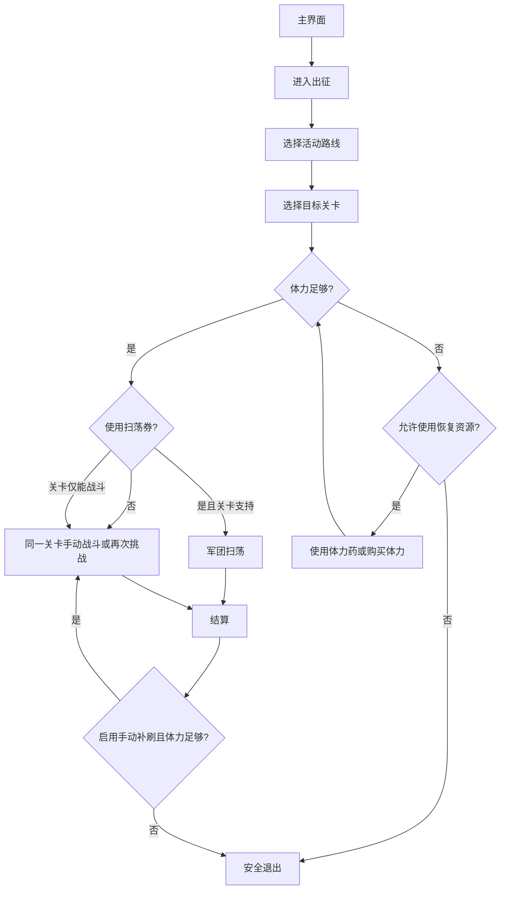

# 消耗体力（DailyStamina）

入口节点：`DailyStaminaStart`；实现涉及 `daily_stamina*.json`、`assets/stamina/active.yaml`、`tools/build_stamina_activities.py` 和 `agent/stamina.py`。本文描述指定关卡的扫荡与手动补刷；按 `NEW` 推进未通关关卡见独立的[自动战斗](auto_battle.md)。

入口经 [统一异常恢复](task_recovery.md) 执行 `DailyStaminaStartAttempt`；首次异常按“遇到故障时行为”重启或暂停，最终失败按继续策略停止或跳过下一步骤。

## 前置状态与可选关卡

- 游戏位于主界面，目标关卡已解锁，战斗队伍与AUTO已预先设置。
- 内置“体力消耗关卡”仅保留“日常调教本”；Trick or Sweet、万圣鹿娘大横行及战争演习预设均已移除，不再列为可选关卡。
- 新活动通过同一步骤的“添加自定义关卡…”录制；已录制的命名配置可选择、修改或删除，操作见[自定义活动关卡](custom_stage.md)。
- 原内置列表索引不再作为自定义配置身份：旧内置选择归到日常调教本，原自定义选择按稳定ID继续关联；删除引用中的自定义配置需重新选择。
- 确认扫荡补刷、体力药与购买体力开关；用药和购买默认关闭。日常调教本直接战斗，不受扫荡补刷开关限制。

日常调教本仍由 assets/stamina/active.yaml 定义，通过 tools/build_stamina_activities.py 生成Interface；用户录制的活动配置保存在本地，不需要修改YAML。生成器另外保留供前端展开命名配置的固定自定义存储项，它不是另一份内置活动。

“日常调教本”使用日常政务路线：复用出征入口 → “目前活动”（OCR）→ 每日政务活动卡（图片）→ “调教”（OCR）→ “开发IV”（OCR）→ “开始”。
活动页默认选中每日政务时，识别所选活动卡模板后复用“进击”进入，不重复点击已选中的卡片。
每日的分类标题、属性前缀会变化，因此分类只识别固定片段“调教”，关卡只识别末尾 `开发\s*(IV|Ⅳ)\s*$`，不匹配“火属”等当日属性或完整标题；普通列表以左侧“Lv”作 marker，避免把分类卡片上的“开发中”误判为关卡列表。
`DailyStaminaPresetActivityName` 在该 Case 中覆盖为 `TemplateMatch`，素材 `DailyStamina/DailyAffairs720.png` 来自 ADB 设备截图，按 720x1280 归一后裁剪“每日政务”字样。
关卡每次消耗 15 体力；详情决策直接进入 `DailyStaminaTrainingStart`，在体力足够且识别到“开始”后点击，不先扫荡，也不受“扫荡不足时手动补刷”开关限制。
结算复用 `DailyStaminaWaitBattleResult`：体力足够时再次挑战，不足时返回地图并退出；战斗 AUTO 须事先开启。首次消费前的体力恢复仍沿用原有开关，战斗后不补充体力。
若开始或再次挑战后仍停在“开始”页，日常调教本会重新识别按钮和体力，足够时最多补点 6 次，不足时进入战斗后的主页返回流程；其他活动默认禁用此补点分支。
该 Case 的首次回复入口点击“开始”触发体力弹窗，回复后返回直接战斗决策；保留原有用药次数和已购买 anchor，不进入扫荡分支。

## 主流程

1. 从主界面进入出征；日常调教本走目前活动和每日政务路线，自定义关卡走所选配置的图片路线。自定义任务默认选择“限时活动”页签，也可改为“每日活动”；页签和入口、关卡一样由无状态图片路由识别。
2. 点击活动页签后先识别底部“进击”或“选择关卡”，确认已到活动卡页；未切换成功时最多重新点击页签三次，禁止在其他页面盲点活动卡坐标。活动卡页默认已经选中第一栏，先检查当前活动名；不匹配时直接尝试第二栏、第三栏，不能再次点击第一栏，否则会进入第一栏活动。每次切换后仍须按活动名称确认，只有名称命中才点击“进击”。`DailyStaminaPresetInnerRouteStart` 必须先确认内部页面 marker，再进入对应 UI 路线：常规活动 UI 进入普通纵向列表或分页列表，复刻活动 UI 进入二维地图，大型活动特殊 UI 进入活动专用路线，日常政务 UI 进入政务分类列表。未进入时最多重试 4 次“进击”，仍失败则返回主界面。
3. 第一次进入第一个目标关卡详情后，由 `DailyStaminaCompare` OCR 当前体力，并与关卡消耗及保留值比较；只有尚未成功扫荡或战斗时，才允许按开关使用体力药或购买体力。
4. “使用扫荡券”默认不勾选：关卡详情走普通开始及再次挑战，不受“扫荡不足时手动补刷”开关限制。勾选后，有军团扫荡的详情页优先扫荡，扫荡不足时按补刷开关继续战斗或停止。日常调教本和仅有开始按钮的关卡仍直接战斗。购买体力成功后执行已购买状态分发器，保证首次消费前最多购买一次。
5. 扫荡动画的“跳过”和结果页的“完成”分别识别与点击；成功扫荡或战斗后进入已消费状态。扫荡后由 `DailyStaminaAfterSweepDecision` 判断是否手动补刷；战斗结算时体力足够则点击“再次挑战”，不足则返回地图并退出，不再补充体力。

## 当前路线

- 内置日常调教本：目前活动 → 每日政务 → 调教 → 开发IV → 开始；结算后再次挑战，体力不足返回主页。
- 用户自定义：低频无状态循环 → 出征/所选活动页签/录制入口/录制关卡任一命中即点击 → 关卡列表向下最多6次 → 扫荡详情或开始页。活动页签默认限时活动，可切换每日活动。
- 历史分页、地图和活动专用节点保留为内部实现，但没有对应的内置关卡选项；不能据此认为过期活动仍被启用。

## 页面识别

| 页面状态       | 识别目标                                            | 识别方式                    | ROI/素材                       |
| -------------- | --------------------------------------------------- | --------------------------- | ------------------------------ |
| 活动区与活动卡 | 限时活动/目前活动及活动名称                         | OCR                         | 由 YAML 模板生成 Override      |
| 关卡列表       | 目标关卡、列表 marker 或第一页 marker               | OCR                         | 由活动配置提供 ROI             |
| 关卡详情       | 军团扫荡、体力值                                    | OCR + `DailyStaminaCompare` | 体力 ROI 默认 `[500,0,180,45]` |
| 战斗与结算     | `WAVE`/`TURN`、`CLEAR`/获得道具、再次挑战、返回地图 | OCR + `DailyStaminaCompare` | `DailyStaminaWaitBattleResult` |
| 体力回复弹窗   | 回复方式、消耗数量、剩余次数、确认/取消             | OCR                         | 弹窗中央与底部按钮区           |

## 异常与分支

- 首次消费前的体力不足弹窗会由游戏选择默认回复页：存在体力药时默认选中“使用道具回复”，没有体力药时默认选中“使用魔晶石回复”。Pipeline 先处理当前默认页；启用体力药时使用游戏排序最靠前的临期药品，每次只确认 1 瓶，首次消费前最多使用 10 瓶。只有当前页与用户启用的回复方式不一致时才主动切换标签；购买体力仍最多确认一次。成功扫荡或战斗后，已消费状态不再进入任何补充体力节点。
- 普通列表有限次上下扫描仍找不到关卡时安全返回，不无限滑动。
- 结算页体力不足时进入 `DailyStaminaBattleExitToMain`。若“返回地图”仍可识别，重新核对体力后再点，累计最多 4 次；按钮消失后，仅在左上返回模板命中时逐页返回，最多 6 次。返回不依赖当前列表仍显示同一个目标关卡，且结算按钮仍可见时不点击左上返回。最终通过公共主页观察与确认结束；退出候选持续无法识别时才转入 `CommonEnsureMain` 恢复，未知页面不能按成功处理。
- 指定关卡只有在体力 OCR 明确满足“关卡消耗 + 预留值”且识别到“军团扫荡”按钮时才会打开扫荡；体力解析失败时返回主界面，不按“足够”处理。
- 扫荡还须明确勾选“使用扫荡券”；未勾选或旧配置缺少选项时，入口、扫荡设置、最大次数和扫荡开始均默认禁用。详情模式路由默认进入普通战斗，复用既有直接战斗的体力判断、首次恢复、再次挑战及退出流程，不直接放开扫荡不足补刷节点。当前队伍和战斗AUTO须提前准备。
- 魔晶石回复页会显示本次价格、回复量和今日剩余次数；现有购买节点仅确认弹窗类型，不限制价格。
- 魔晶石不足且游戏提示使用魂晶购买魔晶石时，Pipeline 会点击该提示的“取消”，回到魔晶石回复页，再复用未购买时的关闭弹窗与返回主界面流程；不会消耗魂晶。
- 确认购买后弹窗不会自动关闭，而是立即刷新成下一次购买确认；Pipeline 会点击“取消”关闭弹窗，并由 `DailyStaminaCurrencyPurchasedState` 记录本次任务已经购买。后续仍有足够体力时继续扫荡/战斗，再次体力不足时直接退出，不再点击入口并打开第二个购买弹窗。
- 道具回复页空状态文本为“目前没有任何的药水可供使用”。有药时弹窗默认选中列表最前的一瓶并显示“是否消耗 1……兑换……体力”；确认后弹窗不会关闭，而是刷新并默认选择下一批药，因此使用节点额外校验数量必须为 1，并在每次使用后主动取消刷新弹窗。确认后不再执行仅凭“取消/确定”识别的二次确认，避免把刷新后的回复页误当作新确认框。
- `DailyStaminaStartSweep` 点击后不等待全屏静止，立即分别监听上下两个实机位置的“跳过”；动画结束后由独立的“完成”节点点击固定中心。只有点击过“跳过”或“完成”后，结果分发器才允许把关卡详情识别为扫荡完成，避免动作尚未生效时提前回到详情决策。
- `DailyStaminaStartSweep` 在 180 秒内未识别到已知后续页面时进入
  `DailyStaminaRecoverSweepTimeout`。恢复分发器只处理已有 Loading、体力回复、扫荡结算、关卡详情、
  关卡列表和主界面；均不匹配时由 `DailyStaminaStopAfterSweepTimeout` 明确返回失败，交给统一异常恢复，不点击未知弹窗。

## 完成状态

- 成功条件：完成目标关卡扫荡/手动补刷，或达到体力、道具、关卡解锁等停止条件。
- 战斗后体力不足是正常完成条件；发出“返回地图”的点击仅代表尝试，仍须继续识图、按需重试，并确认回到主页才能正常结束。
- 已知页面通过详情/列表返回与公共主界面确认结束；扫荡超时且页面无法识别时，`DailyStaminaStopAfterSweepTimeout` 返回失败并交给统一恢复，不能将异常停止当作正常完成。可识别的补充体力弹窗优先取消。

## 自定义截图关卡

“体力消耗关卡”下拉框同时选择内置关卡和本实例自定义关卡，末尾“添加自定义关卡…”可录制，当前选项下“管理自定义关卡”可修改。保存后直接选入当前消耗体力步骤，其他步骤选择不变。自定义配置按稳定ID关联，重命名不失效；删除后需重新选择。具体操作与图片导航边界见[自定义活动关卡](custom_stage.md)。
