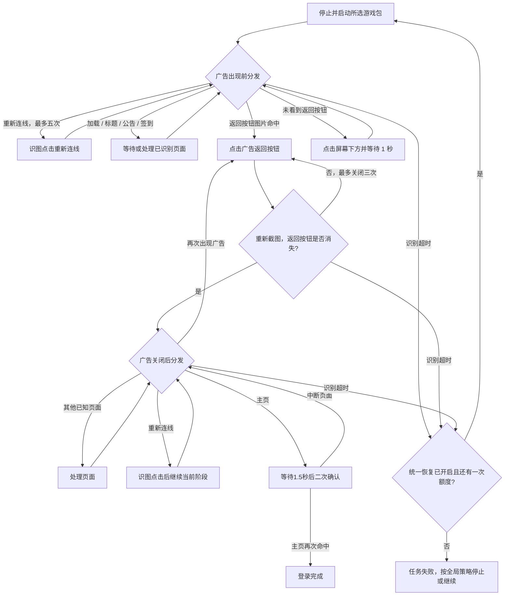

# 启动游戏（GameLogin）

自动准备入口位于 `assets/resource/custom/TkfmRunWithRecovery.cs`；页面状态机位于 `assets/resource/pipeline/game_login.json`。任务列表不再提供“启动游戏”开关，`GameLoginStart` 仅保留为内部兼容入口。

每次真实队列首次执行模块前自动准备游戏；自动连接加载资源不执行设备动作。准备失败沿用当前模块的 [统一异常恢复](task_recovery.md)，最多重启一次。仅登记未来派遣的队列不需要立即启动游戏。

## 前置状态

- 已安装所选渠道游戏并允许 ADB 启动；官服包名为 `com.pinkcore.tkfm`，erolab 为 `com.pinkcore.tkfm.erolabs`。
- 在“资源类型”选择工口服务器或erolab服务器，两者共用同一资源路径。`官服` 保留为首项内部ID，显示工口服务器；旧启动任务中的服务器索引迁移到资源选择。正常启动、异常恢复和定时派遣共用所选资源对应包名。
- 当前流程要求本次启动实际出现广告。未出现广告时不能直接把主页当作登录成功。

## 自动检测

1. 按本实例保存的ADB路径及序列号执行所选包名的 `pidof`，带完成标记区分未运行和查询失败；查询有10秒超时并响应停止，不改绑其他设备。
2. 未运行时直接StartApp并进入原登录状态机；不先结束一个不存在的进程。已运行时用 `dumpsys activity activities` 判断前台，后台游戏只切回前台，保留原页面。
3. 已运行游戏使用设备截图识别已知标题、资源检查、重连、广告及签到页面，命中则从 `GameLoginAfterAdvertisement` 继续登录；已在正常任务页时继续原模块导航。
4. 用当前队列的取消令牌作为准备状态标识，每个真实队列重新检测。派遣按选项关闭游戏后清除标识，后续模块可再次启动。状态检查异常不能当作游戏已运行；不会在连接时自动运行任务。

## 主流程

1. 自动准备直接启动未运行的游戏；异常恢复先停止再启动所选游戏包，进入 `GameLoginDispatch`。
2. 优先识别网络异常弹窗的“重新连线”按钮，命中时点击并返回当前分发器；随后按当前画面处理加载、资源检查、公告、签到及标题页，不假定这些页面全部出现或固定排序。若未看到广告返回按钮且其他已知页面也未命中，则由 `GameLoginWaitTapScreen` 点击屏幕下方中央，等待 1 秒后回到分发器继续识别。
3. 分发器必须命中广告左上角返回按钮的图片，再由 `GameCloseGift` 点击识别位置。广告正文和商品画面可变化，不作为匹配依据。
4. 进入 `GameLoginWaitAdvertisementClosed`，重新截图：返回按钮仍存在则有限次重试；只有独立反向识别节点 `GameLoginAdvertisementGone` 确认按钮消失，才进入 `GameLoginAfterAdvertisement`。
5. 广告关闭后的分发器继续处理加载、公告和签到，再由 `GameLoginConfirmMain` 确认主页并观察 1.5 秒。若出现中断页面则重新分发，否则由 `GameMainReady` 再次确认主页后结束。

## 页面识别与动作

| 页面       | 识别依据                                                                               | 动作                              |
| ---------- | -------------------------------------------------------------------------------------- | --------------------------------- |
| 网络异常   | `GameLogin/Reconnect720.png`，ROI `[235,675,250,100]`，TemplateMatch 阈值 `0.96` | 点击命中框，等待 1 秒后重新分发；每次登录尝试最多五次 |
| 启动广告   | `GameLogin/AdvertisementReturn720.png`，ROI `[0,45,125,65]`，TemplateMatch 阈值 `0.99` | 稳定 300ms 后点击命中框，最多三次 |
| 广告已关闭 | 同一返回图片的独立节点，`inverse: true`                                                | 只进入广告关闭后的分发器          |
| 等待过渡页 | 广告返回按钮模板反向识别命中（即未看到返回按钮）                                       | 点击 `[360,1135]`，等待 1 秒后重试 |
| 资源检查   | `资源检查中` / `档案读取中` OCR                                                        | 等待并重新分发                    |
| 加载       | 公共 `CommonWaitLoading`                                                               | 等待并重新分发                    |
| 公告       | `王城公布栏` / `活动公告` / `最新公告` OCR                                             | 稳定后关闭，最多三次              |
| 签到       | 底部 `TOUCH\s*SCREEN` OCR                                                              | 稳定后点击提示，最多四次          |
| 标题       | `TAP TO START` 或版本号 OCR                                                            | 点击进入，等待 1.5 秒，最多五次   |
| 主页       | “出征”及“调教”同时出现                                                                 | 观察窗口后二次确认                |

所有坐标和素材基于设备内部截图统一到 720×1280，和电脑窗口大小、桌面 DPI 无关。广告返回模板是无损 ADB 原图经 Maa 原生归一化后的裁剪，包含按钮箭头，不包含可变广告内容。

## 恢复与约束

- 广告出现前的 `GameLoginDispatch.next` 没有主页完成分支；主页即使提前出现，也继续等待广告。
- `GameLoginDispatch`、`GameLoginAfterAdvertisement` 和 `GameLoginWaitAdvertisementClosed` 均优先尝试 `GameLoginReconnect`，处理 `GetCDN_SomeError` 等带“重新连线”按钮的弹窗；主页观察阶段同样把该弹窗视为中断。按钮模板由 ADB 内部截图经 Maa 原生归一到 720×1280 后裁剪，不依赖错误正文 OCR。
- 重连仅点击按钮命中框，按钮区域稳定等待 300ms、最长 1500ms；点击后等待 1 秒再回到所属阶段识别，不把点击视为网络已恢复。每次登录尝试累计最多五次，仍有弹窗时由紧随其后的 `GameLoginReconnectExhausted` 进入明确失败路径，不能落入屏幕下方点击兜底。
- `GameLoginWaitTapScreen` 只存在于广告出现前的首次加载分发器，并以返回按钮模板的反向识别作为点击条件；看到返回按钮时该节点不成立，由 `GameCloseGift` 点击返回。
- 点击返回成功后会进入 `GameLoginWaitAdvertisementClosed`，不再回到包含连点节点的 `GameLoginDispatch`。
- 未看到返回按钮时每秒点击一次屏幕下方，用于推进启动画面；点击后仍由分发器识别，不能据此认定广告已出现或登录完成。
- `GameLoginAdvertisementGone` 必须作为独立候选节点运行；MaaFramework 5.14.3 的 And 子识别引用不会应用节点级 `inverse`，不能把反向节点放进 And 当作消失证明。
- 普通加载、标题、公告和签到用 `[JumpBack]` 返回所属分发器；广告关闭通过显式状态转移进入消失确认，不跳回广告出现前的状态。
- 广告关闭前后的分发器候选识别超时均为 360 秒；关闭后的消失确认超时 30 秒。这些不是整轮任务的总时限。
- 超时进入 `GameLoginStopAfterTimeout`，通过始终不命中的节点触发失败，由外层统一动作最多重做一次登录；原 `GameLoginRestartOnce` 只保留失败别名，不再单独重启。关闭恢复或再次超时时，按全局策略停止或继续，当前步骤仍记失败。
- 供其他模块恢复使用时，`TkfmRecoveryRestartGame` 结束所选游戏并进入同一登录状态机；仅将本次子任务的 `GameMainReady` 改为自然结束，不用 `StopTask` 停掉父任务。广告与主页条件保持一致，登录失败不再追加第二次重启。
- 普通日志通过 `focus` 记录等待广告、图片命中、已点击、已确认消失、主页确认；开发者详细日志同时保留匹配分数和点击坐标。点击成功本身不代表广告已经关闭。
- 新广告若改变返回按钮样式或位置，必须重新采集模板。除等待阶段固定点击屏幕下方外，未知页面不盲点，也不绕过广告确认条件。

## 完成状态

新启动或异常重启要求识别并关闭广告、确认按钮消失及主页二次确认；已有正常游戏进程可保留当前任务页，已运行的登录页则继续识别到主页。未覆盖渠道或首次登录分支以独立实机记录为准。
