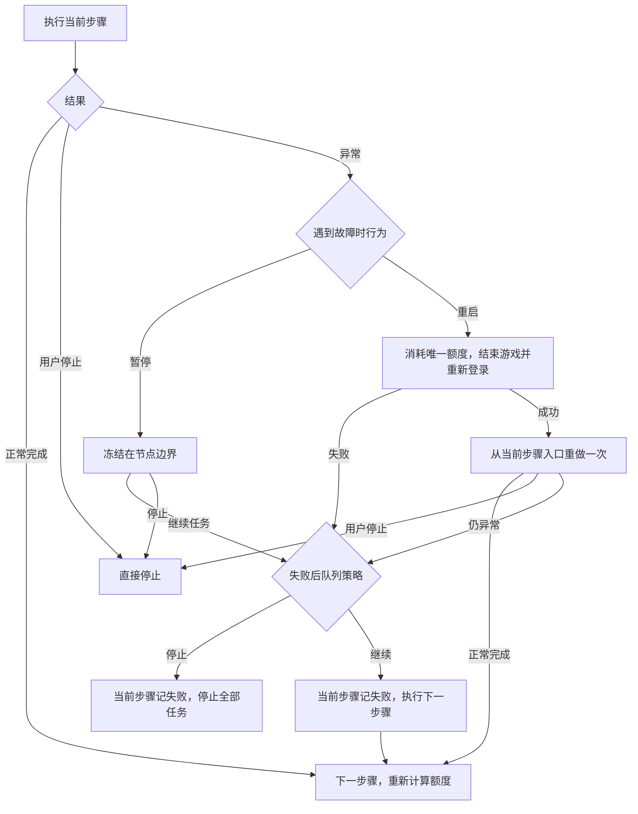

# 统一异常恢复

全部已注册任务使用相同恢复入口；页面导航仍由各模块 Pipeline 状态机执行。
“结束进程”指停止模拟器内所选服务器的游戏，不关闭模拟器或 TKFMaa。

## 执行行为

1. 执行当前步骤原有流程。正常完成、无可领取内容及模块原有的资源不足退出均不触发重启。
2. 流程返回失败或抛出执行异常且用户没有停止时，按“遇到故障时行为”处理：默认“重启”消耗当前步骤唯一重启额度；“暂停”不重启，冻结任务并等待继续或停止。
3. 选择重启时强制停止游戏，重新启动并登录，随后从当前步骤入口重做。重做会根据实际页面状态判断已完成与未完成内容，不回放固定坐标序列。
4. 重启或登录失败、重做后仍异常时不再重启；继续策略决定停止全部任务还是跳过失败步骤。继续时当前步骤仍记为失败，整批结果不会伪装成全部成功。
5. 暂停解除后当前步骤仍返回失败，不把人工继续当作成功；后续停止或跳过继续沿用原生失败策略。任何阶段手动停止都直接退出，不启动恢复。

## 设置与兼容

设置位于前端“游戏设置”的“开发者选单”，在资源扩展随连接初始化加载后显示，按实例保存。

| 设置 | 默认 | 行为 |
| --- | --- | --- |
| 开发者详细日志 | 关闭 | 显示并保存当前实例的真实节点、识别、动作与耗时 |
| 遇到故障时行为 | 重启 | 重启：每个步骤最多一次游戏重启；暂停：首次失败即冻结任务等待人工处理 |
| 重试后仍异常时继续下一步骤 | 关闭 | 暂停解除或重试失败后，关闭时停止全部任务，开启时记录失败并继续 |

故障行为使用 `TkfmFailureBehavior`，缺少新值时按旧 `TkfmRestartFailedStep` 迁移，仍缺少则默认重启；继续策略复用前端 `ContinueRunningWhenError`。
缺少继续策略时采用停止；旧配置已有明确值时保留，不重置用户设置。故障行为下拉框执行中禁用，详细日志开关执行中仍可切换。
服务器读取本实例“资源类型”，正常自动启动、异常恢复和定时派遣共用；旧启动任务的服务器选择迁移后删除该任务。
支持 `com.pinkcore.tkfm` 与 `com.pinkcore.tkfm.erolabs`，不切换账号或安装其他游戏。

## 恢复边界与资源额度

- 覆盖启动游戏、商城、好友体力、炼金订单、每日派遣、消耗体力、调教、全境征才及奖励领取；保留的 `RegularActivityStart`、`AutoBattleStart` 也使用同一恢复动作。
- 重新登录沿用原登录流程：关闭启动广告、确认广告按钮消失、主页观察与二次确认。登录模块的第二次主体执行本身包含停止和启动，不再叠加一次恢复登录。
- 只在模块内已经返回失败后恢复。前端连接失败、资源加载失败、C# 扩展无法加载、进程崩溃和不能返回的底层调用均不由此模块兜底，也不设置额外看门狗。
- 重试清除导航、点击回退及滚动等命中次数，使入口可以重走；保留体力药、购买体力和调教操作次数。保留既有 anchors，不清除已购买体力等状态，重试不会重新发放配置额度。
- 征才通过 `TkfmRecruitmentAttempt1..100` anchors逐次记账，开始征才及领袖跳过各计1次。恢复保留总账、待确认动作及领袖保留状态，不再用 `DailyRecruitmentCycleCompleted` 或入口Gate次数计算剩余额度；仍重新读取词条和实际栏位状态。
- 已领取、已派遣或已经购买的状态由模块现有页面识别与库存规则判断。恢复不是游戏事务回滚；无法确认的页面仍失败，不假定上次点击没有生效。
- 派遣队伍未就绪和扫荡超时无法恢复的分支明确返回失败，交由外层恢复；正常体力不足仍须按原流程回到主页才结束。
- 旧 `AutoBattleStart` 未注册到任务列表，必须人工先选活动列表。重启后没有足够配置自动重建此入口，会因列表无法确认而失败并执行最终策略，不把停在主页当作重试成功。

## 实现映射

- `assets/resource/custom/TkfmRunWithRecovery.cs`：统一执行、唯一恢复额度、服务器选择、计数保留和故障行为分流。
- `assets/resource/custom/TkfmDeveloperSettings.cs`：开发者选单、详细日志开关、故障行为配置及 GitHub-only 更新源清理。
- `assets/resource/custom/TkfmTaskPause.cs`：手动暂停与故障暂停共用的节点边界闸门。
- `assets/resource/pipeline/task_recovery.json`：恢复登录入口、包名映射、受保护计数及明确失败节点。
- 公开入口名保持不变；入口调用统一动作，旧主体改为 `原入口名Attempt`。内部导航回跳只走主体，不递归进入恢复动作。
- 原有Pipeline Override继续覆盖页面节点；服务器包名由资源类型确定。恢复登录只覆盖子任务完成动作，避免StopTask传播到父任务导致无法重做。
- 最终失败返回原生失败状态；停止策略同步清除后续队列，继续策略沿用前端失败后继续机制。日志显示唯一重启、重试结果及最终策略，不将已跳过步骤标记为成功。
