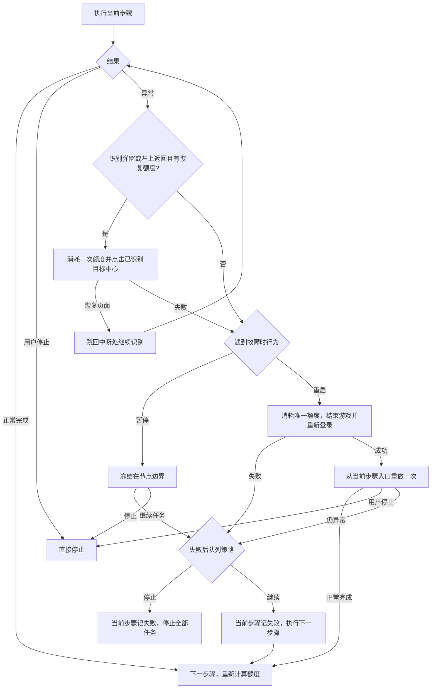

# 统一异常恢复

全部已注册任务使用相同恢复入口；页面导航仍由各模块 Pipeline 状态机执行。
“结束进程”指停止模拟器内所选服务器的游戏，不关闭模拟器或 TKFMaa。

## 执行行为

1. 执行当前步骤原有流程。正常完成、无可领取内容及模块原有的资源不足退出均不触发重启。
2. 页面业务候选前优先识别服务器异常／跨日提示的中部确定按钮，点击后进入登录流程，确认无遮挡出征后继续原任务。页面动作失败或后续识别超时且用户未停止时，同样优先处理此提示，再识别公告、活动签到、月度签到、左上返回按钮或广告箭头。恢复入口共用每任务最多两次额度，包含兼容登录路由的返回；关闭弹窗或返回不等于当前任务完成。没有已知目标、额度耗尽、关闭失败或继续后仍失败时，按“遇到故障时行为”处理：默认“重启”消耗当前步骤唯一重启额度；“暂停”冻结任务并等待继续或停止。
3. 选择重启时强制停止游戏，重新启动并登录，随后从当前步骤入口重做。重做会根据实际页面状态判断已完成与未完成内容，不回放固定坐标序列。
4. 重启或登录失败、重做后仍异常时不再重启；继续策略决定停止全部任务还是跳过失败步骤。继续时当前步骤仍记为失败，整批结果不会伪装成全部成功。
5. 暂停解除后当前步骤仍返回失败，不把人工继续当作成功；后续停止或跳过继续沿用原生失败策略。任何阶段手动停止都直接退出，不启动恢复。

## 弹窗与返回恢复

- 服务器异常／跨日提示用 `GameLogin/SessionExpiredTitle720.png` 和 `GameLogin/SessionExpiredConfirm720.png` 同帧识别：标题ROI `[290,505,140,90]`、阈值0.9，按钮ROI `[235,655,250,110]`、阈值0.94。模板采自“日期已变更，将回到登入界面”的设备内部截图，1080×1920按短边720归一后无损裁剪；标题 `[327,539,63,31]`、按钮 `[263,682,194,48]`。不绑定中间动态原因文字，不把任意普通业务确定按钮当成会话异常；其他服务器错误弹窗的布局兼容性待用户确认。
- `TkfmRecoverySessionExpiredPriority` 在业务 `next` 候选前先识别弹窗，再交给共享额度节点 `TkfmRecoverySessionExpired` 点击确定中点；`on_error` 直接使用后者，避免同一节点同时重复出现在 `next` 和 `on_error`。点击后转 `GameLoginEnsureReady`，登录分发器也优先处理此弹窗，按钮未响应时可消耗剩余额度再点；主界面完成条件明确排除此遮挡。无需强制停止游戏，只有确认无遮挡出征才返回原任务继续识别，保留Pipeline栈、anchors和业务账目。额度耗尽或恢复失败沿用原故障策略。
- 包装器只在本次任务上下文注入恢复分支。异常出口依次为 `[JumpBack]TkfmRecoverySessionExpired`、`[JumpBack]TkfmRecoveryAnnouncement`、`[JumpBack]TkfmRecoveryEventSignIn`、`[JumpBack]TkfmRecoverySignIn`、`[JumpBack]TkfmRecoveryBackButton`、`[JumpBack]TkfmRecoveryAdvertisement`、`[JumpBack]TkfmRecoverySystemBack`，随后才是节点原异常出口；业务候选前另有会话异常优先入口。完整返回按钮先于仅含箭头的广告模板，避免炼金等普通页面被误报成广告。原异常出口为空时使用明确失败节点，恢复额度耗尽不会因分支自然结束而误报成功。
- 所有已知检查不命中后，`TkfmRecoverySystemBack` 通过原控制器 `ClickKey` 发送一次安卓 `KEYCODE_BACK=4`，等待1秒后跳回原步骤重新识别；每任务额外最多三次，游戏重启不重置。它与已知页面恢复的两次额度独立，正向命中 `CommonMainReady` 时不发送，不连续盲按三次、不执行 `adb shell` 或重启模拟器；额度耗尽、输入失败或未知画面仍走原异常出口和暂停／重启策略。
- 路由注入兼容字符串和Maa运行时返回的 `name/jump_back/anchor` 对象，保留既有路由属性并按字段判断优先入口是否已存在，不能将对象数组强制转换成字符串数组。恢复调度自身出错时记录完整堆栈，并继续沿用原故障策略。
- 左上返回匹配 `Common/TopLeftBackFull720.png`，ROI `[0,45,125,65]`、阈值0.9，点击完整按钮图片中心后等待800ms，直接跳回原步骤按当前页面继续；按钮没响应时，后续异常可使用剩余额度再点。模板从设备内部720×1280画面无损裁剪 `[0,53,119,42]`，不点击未知坐标、不关闭或中止生产，不把返回当作模块成功。
- 广告识别复用 `GameLogin/AdvertisementReturn720.png` 和原ROI，点击识别框精确中点。按钮仍在且尚有额度时可再识别重试；按钮消失、公告未命中，并正向识别出征或商城选中标记后，跳回原节点的后续候选继续判断。
- 公告复用既有 `GameCloseAnnouncement` 标题OCR及其底部空白点 `[360,1155]`：王城公布栏／活动公告／最新公告及原繁体变体。当前没有可靠公告模板，故沿用标题OCR；识别到标题即点下方空白区域，无需定位X。标题消失后继续登录路由，识别到无已知遮挡的出征即可，不等待广告出现。
- 活动签到奖励页复用 `GameCloseEventSignIn` 的“结束时间”四字图片，ROI `[100,1020,520,160]`，点击中点后进入 `GameLoginEnsureReady`；活动签到之后可能立即出现魔王月卡页，登录分发器继续按画面处理。
- 魔王月卡恢复 `TkfmRecoverySignIn` 同帧要求 `GameLogin/MonthlyCardTitle720.png` 与 `GameLogin/SignInTouchScreen720.png`，标题ROI `[0,750,190,80]`、阈值0.9，点击框取底部TOUCH SCREEN。标题采自ADB内部1080×1920画面归一720×1280后裁剪 `[14,773,112,32]`，不匹配月份、日期或续订按钮。动作仅点击TOUCH SCREEN中点一次，等待800ms后进入 `GameLoginDispatch`；正常月卡入口 `GameCloseSignIn` 也转入同一分发器。后续王城公布栏复用 `GameCloseAnnouncement` 点击下方空白区域，广告复用 `GameCloseGift` 点击左上箭头，各最多三次；这些是同一登录恢复链的有界页面处理，不额外重新发放恢复额度。确认无遮挡出征后自然跳回原步骤候选，不调用启动或结束游戏动作，也不等待尚未出现的广告。
- `GameCloseSignIn`与`TkfmRecoverySignIn`共用每任务一次月卡点击额度，两个入口均`max_hit: 1`，Agent还联合检查两者命中次数；计入总恢复两次额度。任务开始统一清零，游戏重启前保留。通用TOUCH SCREEN兜底排除魔王月卡标题；即使点击后画面仍在也不补点，交原失败策略，不把输入成功当作任务完成。
- `TkfmRecoveryPopup` 用同一截图及所有恢复动作节点、`GameLoginBackFallback`、`GameLoginExistingGiftFallback` 的共享命中计数限制次数，包含新增月度签到；优先分发节点不重复计数。每个外层任务开始只初始化一次，游戏重启前后不清零。已有进程直接执行任务，不消耗登录准备次数；晚到广告由此恢复。广告与公告关闭后等待最多10秒，无法恢复不无限重试。
- `[JumpBack]` 保留原Pipeline栈、命中计数和anchors，继续判断当前步骤，不重放上次坐标动作。业务分发必须处理恢复后实际页面：征才检测到主页时经 `DailyRecruitmentResumeFromMain` 重新进入当前批次，保留已处理次数和加速提交记录；不能回主页后继续只等某栏弹窗。未知页面或恢复额度耗尽仍执行原故障行为，恢复不等于业务完成。
- 不重新执行模块初始化，不清商城已处理卡片、滚动次数、待购信息或付款尝试次数；不清征才计数、已消耗体力药或购买体力额度。恢复只关闭已识别的弹窗或点击已识别的返回，没有重置账号或资源的行为。

## 设置与兼容

设置位于前端“游戏设置”的“开发者选单”，在资源扩展随连接初始化加载后显示，按实例保存。

| 设置 | 默认 | 行为 |
| --- | --- | --- |
| 遇到故障时行为 | 重启 | 重启：每个步骤最多一次游戏重启；暂停：弹窗恢复仍失败后冻结任务等待人工处理 |
| 重试后仍异常时继续下一步骤 | 关闭 | 暂停解除或重试失败后，关闭时停止全部任务，开启时记录失败并继续 |

故障行为使用 `TkfmFailureBehavior`，缺少新值时按旧 `TkfmRestartFailedStep` 迁移，仍缺少则默认重启；继续策略复用前端 `ContinueRunningWhenError`。
缺少继续策略时采用停止；旧配置已有明确值时保留，不重置用户设置。故障行为及继续策略允许执行中修改，每个模块开始时读取一次；当前模块、暂停状态与重试继续使用开始时的设置，后续尚未开始的模块读取新值，见[运行中修改配置](runtime_settings.md)。日志显示与滚动使用前端原生逻辑，仅定期裁剪为最近100条，不提供自定义详细日志开关。
服务器读取本实例“资源类型”，正常自动启动、异常恢复和定时派遣共用；旧启动任务的服务器选择迁移后删除该任务。
支持 `com.pinkcore.tkfm` 与 `com.pinkcore.tkfm.erolabs`，不切换账号或安装其他游戏。

队列首次执行前，自动启动检查直接读取前端控制器所用的 `processor.Config.AdbDevice` 路径及地址，兼容实例配置在内存保存为设备类型对象的情况；不通过强制读取 JSON 对象判断配置是否存在。确实缺少路径或地址时分别提示缺失字段，仍按已选故障行为处理。

自动启动检查与实时预览共用一个截图控制器，详见[统一截图](shared_capture.md)。队列开始只检查游戏进程：已运行时直接执行当前模块，后台时仅切回前台，不先返回主页或执行登录准备。未运行才启动游戏；冷启动及结束进程后的重新登录识别到无已知遮挡的“出征”即可完成，不要求广告出现或点击。晚到广告、公告和返回按钮由模块异常分支处理；同一队列复用进程准备标记。

## 恢复边界与资源额度

- 覆盖启动游戏、商城、好友体力、炼金订单、每日派遣、消耗体力、调教、全境征才及奖励领取；保留的 `RegularActivityStart`、`AutoBattleStart` 也使用同一恢复动作。
- 重新登录按当前画面分发，广告已经出现时点击其返回按钮，未出现时不等待；识别无已知遮挡的“出征”即完成。登录模块的第二次主体执行本身包含停止和启动，不再叠加一次恢复登录。
- 弹窗恢复发生在模块内异常分支，之后才由外层统一动作处理模块失败。前端连接失败、资源加载失败、C# 扩展无法加载、进程崩溃和不能返回的底层调用均不由此模块兜底，也不设置额外看门狗。
- 重试清除导航、点击回退及滚动等命中次数，使入口可以重走；保留体力药、购买体力和调教操作次数。保留既有 anchors，不清除已购买体力等状态，重试不会重新发放配置额度。
- 炼金的收取、交付和生产提交次数同样保留；订单按剩余数量分别最多尝试三次、总交付最多27次，外层初始化账目，恢复不清空。入口点击前重取画面复核，新建蓝宝石详情须同时命中背后配方列表标题才允许999生产，误开既有生产详情只关闭。次数耗尽且仍有目标明确失败；只有回到主页命中本次完成节点才算成功，详见[炼金订单](daily_alchemy_orders.md)。
- 征才通过 `TkfmRecruitmentAttempt1..100` anchors逐次记账，开始征才及领袖跳过各计1次。恢复保留总账、待确认动作及领袖保留状态，不再用 `DailyRecruitmentCycleCompleted` 或入口Gate次数计算剩余额度；仍重新读取词条和实际栏位状态。
- 商城重启重做跳过 `DailyShopResetExchangeSession` 的清账动作，保留已处理候选、待购信息和累计扫描额度；已领取、已派遣或已购买状态仍由模块现有页面识别与库存规则判断。恢复不是游戏事务回滚；无法确认的页面仍失败，不假定上次点击没有生效。
- 派遣队伍未就绪和扫荡超时无法恢复的分支明确返回失败，交由外层恢复；正常体力不足仍须按原流程回到主页才结束。
- 旧 `AutoBattleStart` 未注册到任务列表，必须人工先选活动列表。重启后没有足够配置自动重建此入口，会因列表无法确认而失败并执行最终策略，不把停在主页当作重试成功。

## 实现映射

- `assets/resource/custom/TkfmRunWithRecovery.cs`：统一执行、共享弹窗额度及唯一游戏重启额度、服务器选择、计数保留和故障行为分流。
- `assets/resource/custom/TkfmDeveloperSettings.cs`：开发者选单、故障行为配置及 GitHub-only 更新源清理。
- `assets/resource/custom/TkfmLogLimit.cs`：每500ms裁剪各实例原生日志到最近100条，不修改日志控件或滚动。
- `assets/resource/custom/TkfmTaskPause.cs`：手动暂停与故障暂停共用的节点边界闸门。
- `assets/resource/pipeline/task_recovery.json`：广告／公告／活动签到／左上返回识别与跳回、恢复登录入口、包名映射、受保护计数及明确失败节点。
- `agent/recovery.py`：五类恢复及已有进程准备时返回的共享额度识别；识别异常保留原因并拒绝命中。
- 公开入口名保持不变；入口调用统一动作，旧主体改为 `原入口名Attempt`。内部导航回跳只走主体，不递归进入恢复动作。
- 原有Pipeline Override继续覆盖页面节点；服务器包名由资源类型确定。恢复登录只覆盖子任务完成动作，避免StopTask传播到父任务导致无法重做。
- 最终失败返回原生失败状态；停止策略同步清除后续队列，继续策略沿用前端失败后继续机制。日志显示唯一重启、重试结果及最终策略，不将已跳过步骤标记为成功。
